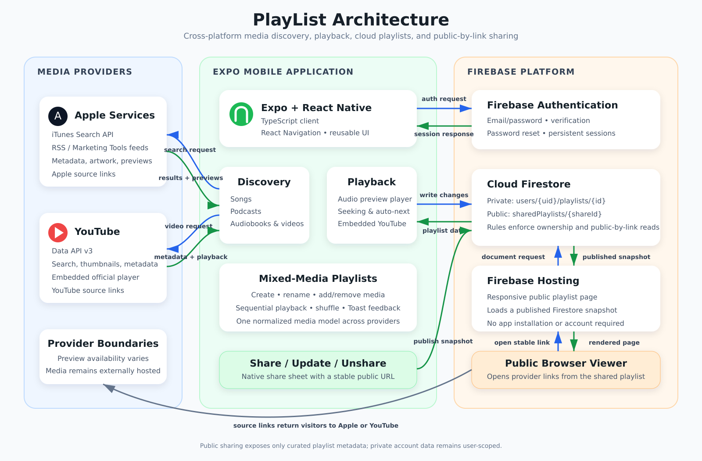

# PlayList


PlayList is a cross-platform media discovery and playlist application built with Expo, React Native, and TypeScript. Users can discover songs, podcasts, audiobooks, and YouTube videos, preview supported media, and organize different media types into cloud-synchronized playlists.

Users can also publish a playlist through Firebase Hosting and share a public browser link with people who do not have the mobile app.

This project began as a class project and was expanded afterward with stronger authentication, Firestore synchronization, richer media discovery, mixed-media playback, public playlist sharing, and a more polished mobile experience.


## How It Works

1. A user creates an account with an email address and password.
2. Firebase sends an email-verification link.
3. After verifying the email, the user can sign in.
4. The user can browse or search for songs, podcasts, audiobooks, and videos.
5. Supported audio previews and YouTube videos can be played inside the app.
6. Media can be added to a new or existing mixed-media playlist.
7. Private playlists are stored in Cloud Firestore and remain available when the user signs in on another device.
8. A playlist can be published as a public-by-link snapshot.
9. The recipient can open the shared playlist in a browser without installing the app or creating an account.
10. A shared playlist keeps a stable link and is updated when its contents change.
11. The owner can unshare the playlist, making its public link unavailable while preserving the private playlist.


## Features

### Authentication and persistence

- Email/password registration and sign-in
- Email verification
- Password-reset email support
- Persistent Firebase Authentication sessions
- User-specific Firestore data protected by security rules
- Cross-device playlist synchronization

### Media discovery

- Song, podcast, audiobook, and YouTube video search
- Top-song and top-podcast discovery with API fallbacks
- Podcast category filtering and episode browsing
- Artwork, creator, duration, description, and source metadata
- Reusable search bars with clear controls

### Playback

- Audio preview playback
- Play, pause, previous, and next controls
- Automatic advancement to the next playable item
- Seekable audio progress bar
- Embedded YouTube playback with official YouTube controls
- App-wide playback coordination to prevent overlapping media
- Sequential and shuffled playlist playback

### Playlist management

- Mixed-media playlists containing songs, audiobooks, podcast episodes, and videos
- Create, rename, and delete playlists
- Add and remove individual media items
- Duplicate playlist and duplicate media feedback
- Toast notifications for playlist actions
- Cloud synchronization through Firestore

### Public playlist sharing

- Public browser-based playlist pages
- Native mobile share sheet
- Stable share link for each playlist
- Automatic updates to an existing shared playlist snapshot
- Public source links to Apple Music, Apple Books, Apple Podcasts, and YouTube
- Unshare option that disables the public link without deleting the private playlist
- Public-by-link Firestore access without exposing all shared playlists through collection queries


## Technology Stack

| Area | Technology | Purpose |
| --- | --- | --- |
| Mobile application | Expo, React Native, TypeScript | Cross-platform mobile development |
| Navigation | React Navigation | Stack and bottom-tab navigation |
| Authentication | Firebase Authentication | Registration, sign-in, verification, password reset, and session persistence |
| Database | Cloud Firestore | User profiles, persistent playlists, cross-device synchronization, and shared playlist snapshots |
| Web hosting | Firebase Hosting | Public browser pages for shared playlists |
| Audio | `expo-audio` | Audio preview playback, progress tracking, and seeking |
| Video | `react-native-youtube-iframe` | Embedded YouTube playback with official controls |
| Media discovery | Apple iTunes Search API | Song, audiobook, podcast, and episode metadata and preview URLs |
| Charts | Apple RSS/Marketing Tools feeds | Top-song and top-podcast discovery |
| Video discovery | YouTube Data API v3 | Video search, thumbnails, and metadata |
| UI | Expo Vector Icons, React Native components | Consistent controls and mobile interface |
| Notifications | `react-native-toast-message` | Success, validation, and error feedback |


## Architecture



The Expo application coordinates several external services:

- **Firebase Authentication** manages user registration, sign-in, email verification, password reset, and persistent sessions.
- **Cloud Firestore** stores private user profiles and playlists, along with intentionally published playlist snapshots.
- **Firebase Hosting** serves public shared-playlist pages that can be opened without the mobile app.
- **YouTube Data API v3** provides searchable video metadata.
- **YouTube's embedded player** handles YouTube playback using official controls.
- **Apple media services** provide searchable metadata, artwork, chart information, external store links, and available preview URLs.

Media from different providers is normalized into a shared TypeScript model so songs, audiobooks, podcast episodes, and videos can coexist in the same playlist.

Private playlist data is stored under the authenticated user:

```text
users/{userId}/playlists/{playlistId}
```

When a user shares a playlist, a restricted snapshot is published separately:

```text
sharedPlaylists/{shareId}
```

Public visitors can retrieve a published playlist only when they possess its exact link. Firestore rules prevent visitors from listing or browsing the entire `sharedPlaylists` collection.


## Sharing and Privacy Model

Shared playlists are public by link.

A published snapshot contains only the information needed to display the playlist:

- Media ID
- Media type
- Title
- Creator
- Artwork URL
- External Apple or YouTube URL

It does not include passwords, authentication tokens, email addresses, private profile information, or audio preview URLs.

Sharing the same playlist again updates its existing shared document instead of creating another link. Unsharing deletes the public snapshot while leaving the user's private Firestore playlist unchanged.


## Media Attribution and Limitations

PlayList is a media-discovery and playlist-management project, not a licensed full-catalog streaming service.

- Apple-provided audio is limited to previews made available by Apple.
- Some chart entries may not have an available preview.
- Podcast availability depends on metadata and episode URLs returned by Apple.
- YouTube videos remain hosted and controlled by YouTube and their respective owners.
- Shared playlist pages link visitors to the original Apple or YouTube source.
- Upstream APIs can occasionally return rate-limit errors, timeouts, or temporary service errors.
- The application uses cached results and fallback searches where practical.
- Source attribution and external links are included for supported providers.


## Learning Outcomes

This project demonstrates:

- Building a multi-screen mobile application with React Native and TypeScript
- Integrating multiple third-party APIs with different response structures
- Designing a normalized model for mixed-media content
- Implementing authentication and user-scoped cloud persistence
- Supporting email verification and password recovery
- Writing and reasoning about Firestore Security Rules
- Separating private account data from intentionally public data
- Designing stable public links and revocable sharing
- Building a responsive public webpage with Firebase Hosting
- Coordinating audio and video lifecycles across navigation screens
- Preventing multiple media sources from playing simultaneously
- Handling asynchronous loading, empty, error, and fallback states
- Managing environment configuration without committing local credentials
- Iterating on usability issues discovered through simulator testing
- Balancing technical capability with API, copyright, and platform limitations


## 🎥 Demo

[Watch the PlayList Demo](https://drive.google.com/file/d/1USERF_wqeqzHbtu1JTp8KCkwkN9frNSf/view?usp=sharing)


## Running the Project

### Prerequisites

Install or create the following before running the application:

- Node.js and npm
- Expo Go on a physical mobile device, or an iOS/Android simulator
- A Firebase project
- A Cloud Firestore database
- Firebase Authentication with Email/Password enabled
- A YouTube Data API v3 key
- Firebase CLI if deploying the shared-playlist website

### 1. Clone the repository

```bash
git clone https://github.com/erikamanley451/playlist.git
cd playlist/playlist57
```

### 2. Install dependencies

```bash
npm install
```

### 3. Configure environment variables

Copy the example environment file:

```bash
cp .env.example .env
```

Add your configuration values to `.env`:

```env
EXPO_PUBLIC_FIREBASE_API_KEY=
EXPO_PUBLIC_FIREBASE_AUTH_DOMAIN=
EXPO_PUBLIC_FIREBASE_PROJECT_ID=
EXPO_PUBLIC_FIREBASE_STORAGE_BUCKET=
EXPO_PUBLIC_FIREBASE_MESSAGING_SENDER_ID=
EXPO_PUBLIC_FIREBASE_APP_ID=

EXPO_PUBLIC_YOUTUBE_API_KEY=

EXPO_PUBLIC_SHARED_PLAYLIST_URL=https://YOUR_PROJECT_ID.web.app
```

### 4. Configure Firebase Authentication

In Firebase Console:

1. Open **Authentication**.
2. Select **Sign-in method**.
3. Enable **Email/Password** authentication.
4. Configure the email-verification template.
5. Configure the password-reset template.
6. Add any required authorized domains.

### 5. Create Cloud Firestore

Create a Cloud Firestore database in Firebase Console.

The application stores private playlists under each authenticated user's UID and publishes intentionally shared snapshots in the top-level `sharedPlaylists` collection.

### 6. Configure Firestore Security Rules

The project includes a version-controlled `firestore.rules` file.

```text
rules_version = '2';

service cloud.firestore {
  match /databases/{database}/documents {
    function isSignedIn() {
      return request.auth != null;
    }

    function ownsData(userId) {
      return isSignedIn()
        && request.auth.uid == userId;
    }

    match /users/{userId} {
      allow create, read, update, delete:
        if ownsData(userId);

      match /playlists/{playlistId} {
        allow read, write:
          if ownsData(userId);
      }
    }

    match /sharedPlaylists/{shareId} {
      // Anyone with the exact link can retrieve a published playlist.
      allow get:
        if resource.data.published == true;

      // Prevent visitors from browsing every shared playlist.
      allow list:
        if false;

      // Signed-in users can publish their own playlist snapshot.
      allow create:
        if isSignedIn()
        && request.resource.data.ownerId == request.auth.uid
        && request.resource.data.published == true
        && request.resource.data.name is string
        && request.resource.data.items is list
        && request.resource.data.items.size() <= 250;

      // Only the owner can update the shared snapshot.
      allow update:
        if isSignedIn()
        && resource.data.ownerId == request.auth.uid
        && request.resource.data.ownerId == resource.data.ownerId
        && request.resource.data.name is string
        && request.resource.data.items is list
        && request.resource.data.items.size() <= 250;

      // Only the owner can remove the shared snapshot.
      allow delete:
        if isSignedIn()
        && resource.data.ownerId == request.auth.uid;
    }
  }
}
```

Publish the rules in **Firestore Database → Rules**, or deploy them with Firebase CLI:

```bash
firebase deploy --only firestore:rules
```

### 7. Configure YouTube

In Google Cloud Console:

1. Enable **YouTube Data API v3**.
2. Create an API key.
3. Add the key to `EXPO_PUBLIC_YOUTUBE_API_KEY` in `.env`.
4. Apply appropriate API and application restrictions before deployment.

### 8. Configure Firebase Hosting

Install Firebase CLI if needed:

```bash
npm install -g firebase-tools
```

Authenticate:

```bash
firebase login
```

Connect the local project to your Firebase project:

```bash
firebase use --add
```

Choose the Firebase project that should host the shared-playlist website.

Confirm that `.env` contains its public Hosting URL:

```env
EXPO_PUBLIC_SHARED_PLAYLIST_URL=https://YOUR_PROJECT_ID.web.app
```

Deploy the public sharing website:

```bash
firebase deploy --only hosting
```

Firebase Hosting only needs to be redeployed when files under `public/` or the Hosting configuration change. It does not need to be redeployed every time Expo starts.

### 9. Start the Expo Development Server

```bash
npx expo start
```

Then choose one of the following:

- Scan the QR code with Expo Go on a physical device.
- Press `i` to open the iOS Simulator on macOS.
- Press `a` to open an available Android emulator.

If Metro appears to be using stale code, restart it with:

```bash
npx expo start --clear
```


## Project Status

PlayList is an educational portfolio project. It is not affiliated with, endorsed by, or sponsored by Apple, YouTube, Google, or Firebase.

All third-party names, artwork, metadata, previews, and playback services belong to their respective owners.

